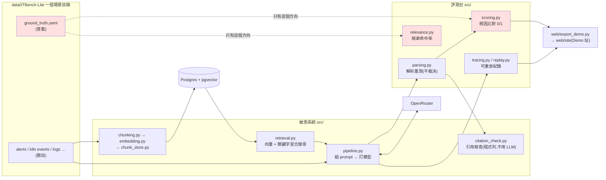
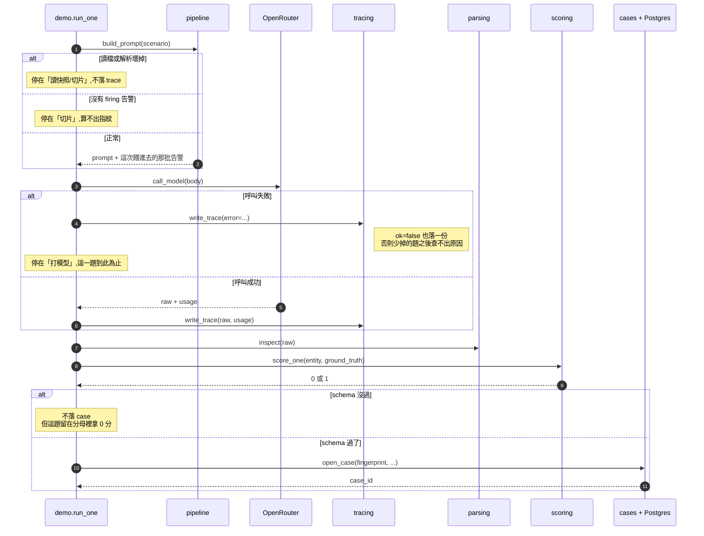

# EvalBench

工程維運事故排查 agent 的**評測台**。餵它一份 K8s 事故現場快照(告警、K8s events、log 等觀測資料),它產出根因假設與證據鏈,**不自己動手修**。這個 repo 的重點是量它的那把尺:每一題怎麼判對錯、每一次呼叫怎麼留下可重放的紀錄、分數怎麼報才不會騙人。

**🔎 Demo 站:<https://q20274982.github.io/evalbench/>**(過渡版,中文/English 可切換)

---

## Demo 站

不用裝任何東西,打開就能看每一次評測的結果:

- 首頁是事故清單,一題一列,整列可點
- 點進去看那一題餵給模型的輸入、檢索到的段落、模型的回答、評分怎麼判、引用檢查的結果
- 分數**按輪次分開報**(例如「第 1 輪 14/25、第 2 輪 14/25、第 3 輪 14/25」),不合併成單一數字;只跑一輪的批次照實標「1 round」

幾件要知道的事:

- **純靜態**。網站不連資料庫、不呼叫模型,只讀 `web/site/snapshot/` 底下匯出好的 JSON。
- **2026-10-12 到 10-16 的幾批**是早期實驗,當時只存了回答、分數與檢索段落編號,沒存輸入全文。網站照實寫「這一次沒有存下輸入」,不回頭重建。
- **引用檢查那一欄是匯出時重算的**(trace 沒存當時的檢查結果),網站上有標明。
- 這是過渡版,之後會由正式的儀表板取代。

本機開法(匯出需要 `traces/` 與資料集,所以只有在跑過評測的機器上能重新匯出):

```bash
docker compose run --rm app uv run python web/export_demo.py   # 匯出 → web/site/snapshot/
docker compose up -d demo                                      # http://localhost:8080
```

發佈:`web/site/` 有改動並推上 `master` 時,`.github/workflows/pages.yml` 會把它原樣發佈到 GitHub Pages。

---

## 目前的架構



**紅色框是答案的邊界**:`ground_truth.yaml` 只准往評分那一側流(`scoring.py`、`relevance.py`、匯出 Demo 站的腳本)。組 prompt、切塊、建索引、檢索都不准讀它。這條線畫錯,整個評測台量到的分數就是自己餵給自己的。程式碼註解裡的 `INV-13` 指的就是這條。

組 prompt 有兩條路,並存在 `pipeline.py`:

- `build_prompt`:最早的基準版,寫死的截頭(告警前 12 則、events 前 20 行 × 400 字),不是檢索。`src/demo.py` 走這條。
- `build_retrieval_prompt`:在同一題的塊裡做混合搜尋,取前幾塊組進 prompt。檢索相關的實驗走這條。

---

## 模組職責

### `src/`

| 檔案 | 職責 | 要記得的一件事 |
| --- | --- | --- |
| `config.py` | 環境常數唯一入口,本體檔一律 `from config import settings` | **import 時就實體化 `Settings()`**——必要的環境變數缺任何一個,啟動就爆,不會拖到連線時才發現 |
| `pipeline.py` | 讀快照 → 組 prompt → 打模型 | 截頭版與檢索版並存;截頭版刻意保留,當作比較的基準 |
| `chunking.py` | 把一題的六種觀測資料切成要算 embedding 的塊 | 只切不存;每塊的 `text` 是原句,一個字都不改,合併資訊放附帶欄位不進 `text` |
| `embedding.py` | 塊的文字送 OpenRouter 換成向量 | 超過模型上限的塊按比例截短再送;截短只影響向量,原文不動 |
| `chunk_store.py` | 塊與向量存進 Postgres + pgvector | 續跑時比對原文 md5,切法改過的塊會重算,避免舊向量配新文字 |
| `retrieval.py` | 從告警與 events 組查詢,做向量 + 關鍵字混合搜尋 | 兩份名次表用 RRF 合併;查詢的組法、拆字方式都留了開關,供對照實驗切換 |
| `citation_check.py` | 檢查一筆診斷有沒有憑據 | 用程式判不用 LLM:每條 evidence 要逐字出現在檢索結果裡,根因實體要逐字出現在 evidence 裡 |
| `diagnosis.py` | 「診斷結果」的資料形狀,四個欄位 | `root_cause_entity` 必填,是評分唯一看的那一欄 |
| `parsing.py` | 四層量測:表面特徵 / strict JSON / 剝圍欄 / pydantic | **只量測不裁決**;pydantic 走 `strict=True`,不把 `"0.8"` 悄悄轉成 `0.8` |
| `scoring.py` | 根因比對,0/1 沒有部分分 | 判官是程式不是模型,整個檔沒有模型呼叫 |
| `relevance.py` | 量檢索:一塊算不算證據、命中率@k | **不 import `retrieval.py`**——量尺不跟被測系統共用判斷程式 |
| `cases.py` | 建表 + 寫一筆 case | 目前**刻意不去重**(見下方「刻意的簡化」) |
| `tracing.py` | 把一次呼叫的前因後果寫成檔案 | 存 prompt 全文、request body(不含 API key)、檢索結果、code commit 與評分程式版本 |
| `replay.py` | 只拿一個 trace 檔重放當初那次呼叫 | `check` 不花錢、`live` 真的再送一次;判定看 `root_cause_entity` 不看逐字 |
| `demo.py` | 端到端入口:快照進 → 截頭 → 模型 → 解析 → 落 case + 存 trace | **成功燈不看分數**——五段走完沒、case 在不在、trace 檔在不在才是判定 |

### `tests/`

| 檔案 | 測什麼 | 需要 DB |
| --- | --- | --- |
| `test_config.py` | 環境變數齊不齊 | |
| `test_diagnosis.py` | pydantic 的驗證發生在什麼時候 | |
| `test_scoring.py` | 評分層照規則判 | |
| `test_tracing.py` | trace 寫得出去、讀得回來、失敗的呼叫有沒有落檔 | |
| `test_cases.py` | case 表寫得進去、指紋算得穩、目前刻意不去重 | ✅ 寫進 `test_w1` schema,不碰 `public` |
| `test_layout.py` | **相依方向**,不測功能(見下方「界線」) | |

---

## 一題的生命週期(`demo.run_one`)



錯誤處理的形狀是**題內停、題間繼續**:任何一段壞掉就這一題到此為止、記下停在哪,下一題照跑。解析失敗的題**留在分母裡拿 0 分**,不從統計裡消失。

---

## 刻意的簡化

這幾處目前**故意**沒做,之後會先把它弄壞、再修:

| 簡化 | 落在哪 |
| --- | --- |
| 工具沒有去重鍵(`cases` 沒有 UNIQUE,`occurrence_count` 固定 1) | `cases.py` |
| 權限只寫在 prompt 裡,沒有程式層的檢查 | — |
| 沒有核准機制(`proposed_action` 直接寫進 case) | `demo.PROPOSED_ACTION` |
| 沒有資源上限 | — |

---

## 常用指令

執行一律走容器。

| 想做什麼 | 指令 |
| --- | --- |
| 起 Postgres | `docker compose up -d db` |
| 跑 demo(單題) | `docker compose run --rm app uv run python src/demo.py` |
| 跑 demo(全部題目 × 3 輪,會花錢) | `docker compose run --rm app uv run python src/demo.py --all` |
| 跑全部測試 | `docker compose run --rm app uv run pytest tests/` |
| lint | `docker compose run --rm app uv run ruff check src/ tests/` |
| 重放:只檢查不花錢 | `docker compose run --rm app uv run python src/replay.py check traces/<run_id>/<場景>_<輪>.json` |
| 重放:真的再送一次 | `docker compose run --rm app uv run python src/replay.py live traces/<run_id>/<場景>_<輪>.json` |
| 進 psql 看 case 表 | `docker compose exec db psql -U $POSTGRES_USER -d $POSTGRES_DB -c 'select * from cases'` |
| 匯出並開 Demo 站 | 見上方「Demo 站」 |

環境變數照 `.env.example` 填一份 `.env`。根目錄的 `traces/` 與 `data/` 不進版控(Demo 站匯出的 `web/site/snapshot/traces/` 會進);資料集要自己下載到 `data/ITBench-Lite/`。

---

## 界線:`src/` vs `experiments/`

`experiments/` 底下**一個資料夾 = 一個實驗**,跑完之後就不回頭改。這條界線由 `tests/test_layout.py` 自動守,三條規則:

1. `src/` 與 `tests/` 不准指到 `experiments/`(import 或路徑字串都算)
2. 實驗之間不准互相 import,同一個資料夾裡的檔案可以
3. 實驗**可以** import `src/`——實驗量的就是評測台本身,複製一份 `scoring` 進實驗裡就不是在量那一支了

```
experiments/
├── W00/  0-1-divergence, 0-2-score-variance, 0-5-random-baseline,
│         env-checks, smoke-inv1-injection, otel_demo_smoke
├── W01/  1-1-inventory, 1-2-structured-output, 1-3-baseline,
│         7-5-layer2-probe, 7-6-replay-spread
└── W02/  2-1-string-queries, 2-2-entity-match-poc, 2-2-evidence-trial,
          2-3-chunking, 2-3-fault-types, 2-4-citation, 2-6-agent,
          2-6-embed, 2-6-events, 2-6-hybrid, 2-6-relevance-compare,
          2-6-vector-baseline, inv9-smoke, layer2-format-probe,
          openrouter-embed-probe
```

---

## 現況

code repo `e1b68c8`,2026-11-13 在本機 venv 跑 `pytest tests/`:**35 passed、2 skipped**(skip 的兩支在 `test_cases.py`,當時 Postgres 沒起)。

設計決定的紀錄(考慮過什麼、選了什麼、為什麼)放在作者的私人筆記,沒有公開;程式碼註解裡的 `§` 編號與 `W01`、`W02` 這類週次指的是那份筆記。

---

## 資料來源

事故資料來自 ITBench-Lite(IBM Research,Apache License 2.0;[ITBench](https://github.com/itbench-hub/ITBench)、[論文](https://arxiv.org/abs/2502.05352))。Demo 站的 `web/site/snapshot/` 含從這份資料衍生的告警、events 與標準答案。
